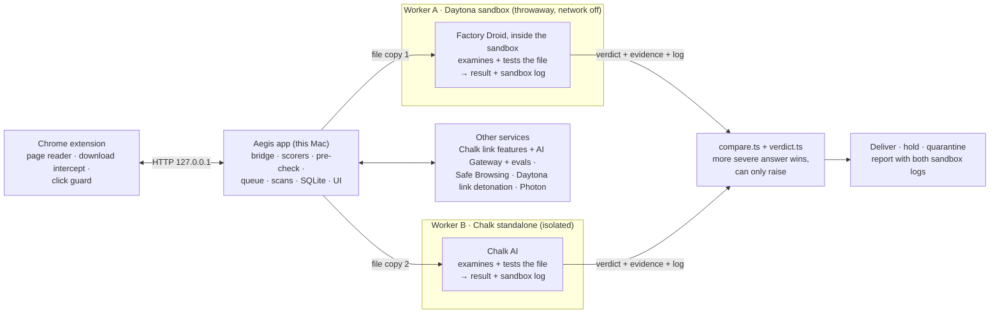
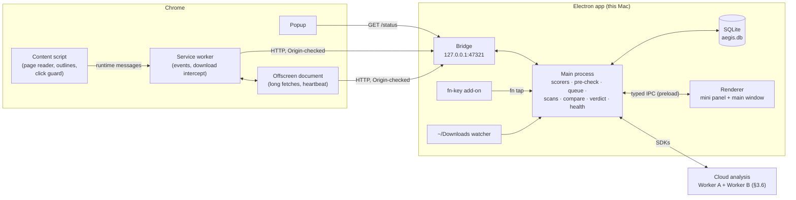
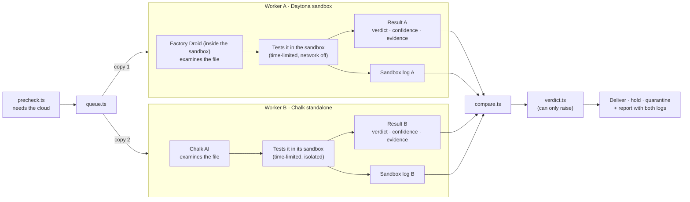
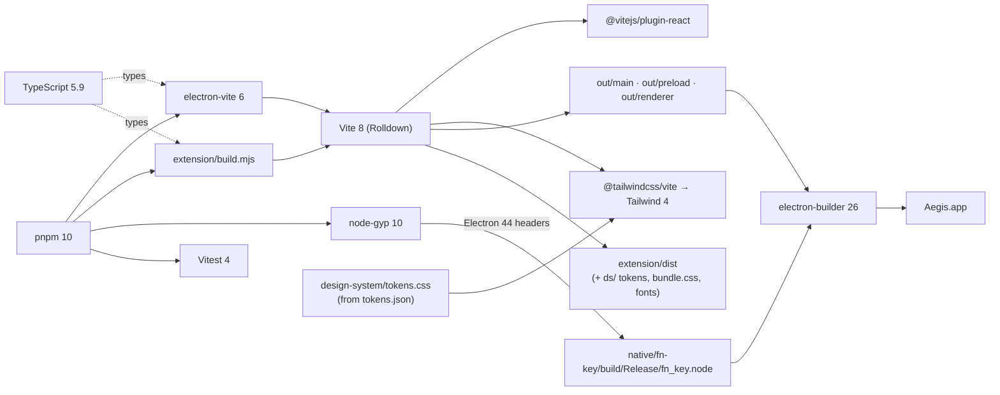
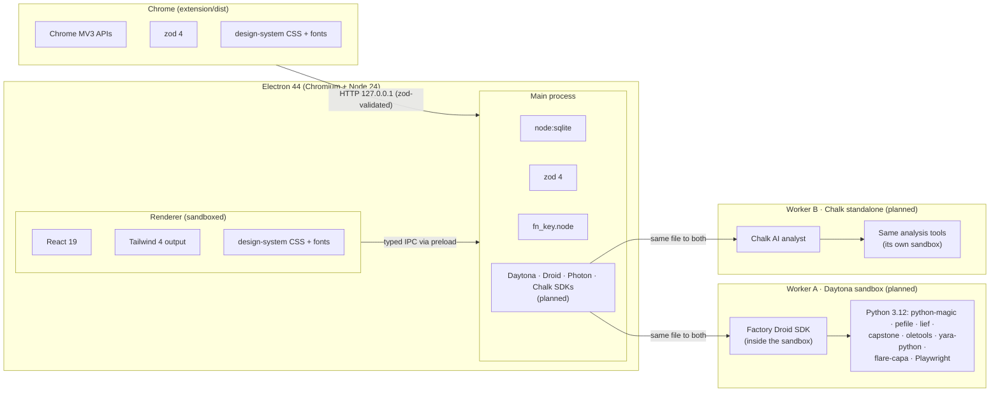
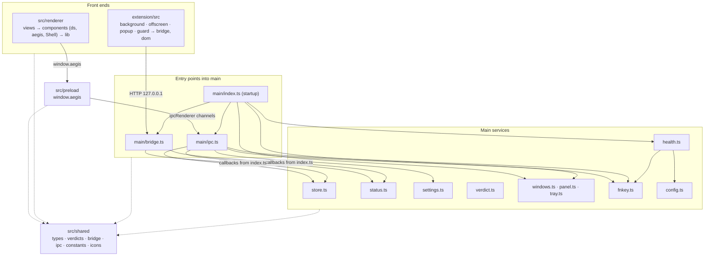
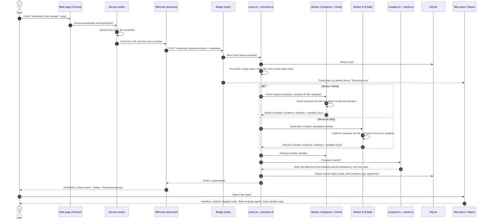
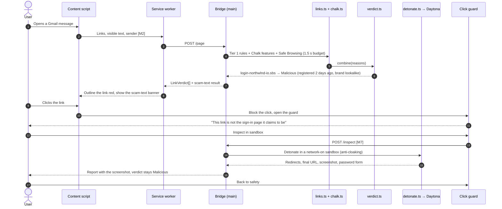

# Aegis architecture

How Aegis is put together: what each part does, how the parts relate, how data moves through
them, and which libraries hold it up. Behaviour and safety rules come from `MEGA_PROMPT.md`, build
order from `BUILD_PROMPT.md`, the look from `design-system/` and `figma/`. Live status is in
`docs/PROGRESS.md`; decisions are in `docs/PLAN.md`.

Every part below is marked **Built** (in the repo and working today) or **Planned (M*n*)** (the
milestone that builds it).

---

## 1. What Aegis is

Aegis checks links and downloads **before** they reach your Mac. Anything risky is opened in a
throwaway cloud sandbox, never on the Mac, reverse engineered, and explained in plain English with
the suspicious code as evidence. Every URL and file gets one of four verdicts: **Malicious**,
**Suspicious**, **Unknown** or **Clean**.

It works in three places:

| Where        | What the user sees                                                                                | Part                        |
| ------------ | ------------------------------------------------------------------------------------------------- | --------------------------- |
| **Chrome**   | Risky links outlined, a click guard on dangerous clicks, downloads held until scanned             | Chrome extension            |
| **The Mac**  | Menu bar icon, mini panel (fn / ⌃⌥A), main window with history and reports; `~/Downloads` watched | Electron app                |
| **Messages** | Forward a sketchy text, email or link to Aegis and get a verdict back                             | Photon agent inside the app |

Four sponsors each do load-bearing work. Every risky file is reverse engineered by **two
independent workers at once**, and Aegis compares their answers:

- **Worker A — Daytona + Factory Droid:** a throwaway **Daytona** sandbox with **Droid** living
  inside it as the analyst. Droid examines the file, tests it inside the sandbox, and reports
  back; if the test errors or shows harmful behaviour, it reports the file as dangerous.
- **Worker B — Chalk (standalone):** the same job done independently by **Chalk**'s AI in its own
  isolated environment.

Both return a verdict, their evidence and **a log of what happened in their sandbox**. **Photon**
carries the messaging channels, and **Chalk** also supplies the link threat-intel features, the LLM
gateway and the evals that measure how often each worker, and the pair, is right.

---

## 2. System overview

### 2.1 The big picture



### 2.2 Inside Chrome and the app



**Trust boundaries** (MEGA_PROMPT §6, BUILD_PROMPT §2):

- **No sample ever runs on the Mac.** The main process may read bytes (pre-check) and hold or
  quarantine files. A file is tested only inside a worker's sandbox: a fresh environment per job,
  network off, time-limited, with no access to the Mac, destroyed when the job ends (local Docker
  with the same limits is the fallback if Daytona is down).
- **Two opinions, never fewer checks.** The workers run independently on their own copy of the
  file. The comparator takes the more severe answer when they disagree, and the result can only
  raise the rule-based verdict, never lower it.
- **Sandbox logs are evidence, not instructions.** Each worker's log is stored and shown in the
  report, and fenced as untrusted data whenever a model reads it.
- **Secrets stay in the main process.** API keys live in `.env` (or Electron `safeStorage`). The
  renderer gets a narrow typed API; the extension never sees a key and only talks to the bridge.
- **The bridge** listens on `127.0.0.1` only and accepts a request only when its `Origin` is the
  extension's fixed ID and its `Host` is the loopback address.
- **The renderer** runs sandboxed (`contextIsolation`, no Node, strict CSP, no remote content).
- **Untrusted text** (page text, emails, strings and code from samples) is fenced in every model
  prompt, and **AI can only raise a verdict, never lower it** (`src/main/verdict.ts`).
- **Clean documents never leave the Mac**: the pre-check clears them locally.

---

## 3. The parts, and how each relates to the whole

### 3.1 Shared contract — `src/shared/` · Built

The one set of types every other part imports, so the extension, main process and renderer can't
drift apart. Changing it is a joint decision (noted in the Handoff).

| File           | What it holds                                                                                                                                        |
| -------------- | ---------------------------------------------------------------------------------------------------------------------------------------------------- |
| `types.ts`     | zod schemas and types: `Verdict`, `Finding`, `Reason`, `LinkVerdict`, `ScanReport`, `DroidReport`, `CodeExcerpt`, `SandboxRecord`, health and status |
| `verdicts.ts`  | The only verdict → word → badge-level mapping, ranks for "AI can only raise", action labels                                                          |
| `bridge.ts`    | Every bridge route with request/response schemas (`/status`, `/ping`, `/page`, `/download`, `/inspect`, `/scan/:id`, `/trust`)                       |
| `ipc.ts`       | Every renderer ↔ main channel and its argument/result types, plus the `AegisApi` the preload exposes                                                 |
| `constants.ts` | Extension ID, bridge port, score thresholds, timeouts, file-type lists, panel size                                                                   |
| `icons.ts`     | Icon path data shared by the app and the extension                                                                                                   |

### 3.2 Chrome extension — `extension/`

The eyes in the browser. It reads pages, intercepts downloads and shows warnings, but makes no
decisions itself: every verdict comes from the app through the bridge.

| Part                          | Status          | Role                                                                                                    |
| ----------------------------- | --------------- | ------------------------------------------------------------------------------------------------------- |
| `public/manifest.json`        | Built           | MV3 manifest with a fixed `key`, so the ID is `onljkbhkoinihmjibfofcalimkolemam` everywhere             |
| `src/background.ts`           | Built (partial) | Service worker: keeps the offscreen document alive, toolbar badge. Download interception lands in M3    |
| `src/offscreen.ts`            | Built (partial) | Long-lived document: bridge heartbeat today; in-memory download fetch and streaming in M3               |
| `src/popup.ts`                | Built           | App status, page counts, recent verdicts                                                                |
| `src/guard.ts`                | Built (UI)      | Click guard in a closed Shadow DOM (Figma frame). Wired to real verdicts in M2                          |
| `src/bridge.ts`, `src/dom.ts` | Built           | Bridge client (zod-validated) and DOM helpers using the design system's classes                         |
| `src/content.ts`              | Planned (M2)    | Collects links, visible text and webmail sender; draws outlines; scam-text banner; opens the guard      |
| `build.mjs`                   | Built           | Builds each entry as a classic script with Vite; copies the design-system CSS and fonts into `dist/ds/` |

### 3.3 Electron main process — `src/main/`

The brain. It owns the bridge, every decision, every outside service, the store and the windows.

| Module                              | Status           | Role                                                                                              |
| ----------------------------------- | ---------------- | ------------------------------------------------------------------------------------------------- |
| `index.ts`                          | Built            | Startup order: identity → `.env` → store → bridge → IPC → tray → shortcuts → panel → health loop  |
| `bridge.ts`                         | Built (partial)  | HTTP server for the extension. `/status`, `/ping`, `/trust` live; the rest answer 501 until built |
| `store.ts`                          | Built            | SQLite schema, migrations, queries behind every screen (`node:sqlite`, no native module)          |
| `status.ts`                         | Built            | Live app status (protection state, health, page snapshot, active scans) and the scan log          |
| `health.ts`                         | Built            | Checks every connection at start, every 60 s and on demand; drives "degraded"                     |
| `verdict.ts`                        | Built            | Score bands, hard rules, Unknown, "AI can only raise". Every verdict passes through here          |
| `settings.ts`, `config.ts`          | Built            | User settings in SQLite; secrets and config from `.env`                                           |
| `ipc.ts`                            | Built            | Handlers for every channel in `src/shared/ipc.ts`                                                 |
| `windows.ts`, `panel.ts`, `tray.ts` | Built            | Main window, the fn/⌃⌥A mini panel (top-right, no focus steal), menu bar icon and menu            |
| `fnkey.ts`                          | Built            | Loads `native/fn-key`; a clean fn tap toggles the panel                                           |
| `demo.ts`, `devcapture.ts`          | Built (dev)      | `AEGIS_DEMO=1` demo database; headless screenshots for design checks                              |
| `links.ts`                          | Planned (M2)     | Tier 1 link rules, Tranco, allow list, URL secret stripping                                       |
| `chalk.ts`, `text.ts`               | Planned (M6)     | Chalk online features (cached), AI Gateway client; scam-text check                                |
| `precheck.ts`                       | Planned (M3)     | Magic bytes, SHA-256, size, macro / script / PDF-action detection. Reads bytes only               |
| `queue.ts`                          | Planned (M3)     | Sandbox job queue: 3 at once, priorities, daily budget                                            |
| `daytona.ts`, `docker.ts`           | Planned (M3, M8) | One interface for sandboxes: create, upload, run, download, destroy (always in `finally`)         |
| `scans.ts`                          | Planned (M3)     | The download pipeline and its persisted state machine (`received → … → compared → done`)          |
| `workerA.ts` (Daytona + Droid)      | Planned (M4)     | Starts a Daytona sandbox with Droid inside, hands it the file, collects verdict, evidence and log |
| `workerB.ts` (Chalk)                | Planned (M6)     | Runs the same job through Chalk's standalone worker, collects verdict, evidence and log           |
| `compare.ts`                        | Planned (M4, M6) | Compares the two workers' answers and produces one result for `verdict.ts` (rules in §3.6)        |
| `detonate.ts`                       | Planned (M7)     | Decides when to detonate a link, queues it, rescans the final URL                                 |
| `watcher.ts`, `quarantine.ts`       | Planned (M8)     | `~/Downloads` watcher; quarantine, restore, delete                                                |
| `photon.ts`                         | Planned (M5)     | Inbound messages → checks → replies; alerts; thread storage                                       |

### 3.4 Preload — `src/preload/` · Built

The renderer's only door into the main process: `window.aegis.invoke / send / on` over a fixed
list of channels. It runs sandboxed and imports nothing at runtime except Electron and the channel
list.

### 3.5 Renderer — `src/renderer/` · Built

One React bundle for two windows, routed on the URL hash: `#/panel` is the mini panel, `#/main` is
the main window. It only displays and asks; it never decides a verdict or touches a key.

| Part                                       | Role                                                                                           |
| ------------------------------------------ | ---------------------------------------------------------------------------------------------- |
| `views/Panel.tsx`                          | Mini panel (Figma frame): status, service dots, this page, scanning now, recent verdicts       |
| `components/Shell.tsx`                     | Fixed frame: nav rail, top bar with ⌘K search and status chip; only the content column scrolls |
| `views/main/*View.tsx`                     | Overview, Links, Downloads, Report (Figma frame), Messages, Accuracy, Settings, Search         |
| `components/ds/`                           | Typed React port of `design-system/components/bundle.js`, styled by `bundle.css`               |
| `components/aegis.tsx`, `assets/aegis.css` | Figma-only components: VerdictBadge, StatusDot, ScanSteps, Timeline, CodeBlock, chips          |
| `lib/hooks.ts`, `lib/format.ts`            | Live status, IPC data hooks, scan log; formatting for machine output                           |
| `assets/main.css`                          | Tailwind v4 with the design tokens mapped in `@theme`                                          |

### 3.6 Analysis workers — two independent reverse engineers · Planned (M3, M4, M6)

Once the local pre-check decides a file needs the cloud, `scans.ts` sends **the same file to two
workers at the same time**. Neither sees the other's answer. Each one examines the file, tests it
inside its own sandbox, and returns a structured result plus a log of everything that happened in
its sandbox. When both finish (or the time limit ends), `compare.ts` reconciles them.



**What each worker returns** (`WorkerResult`, to be added to `src/shared/types.ts` and validated
with zod in the main process):

| Field        | What it holds                                                                                                            |
| ------------ | ------------------------------------------------------------------------------------------------------------------------ |
| `worker`     | `daytona-droid` or `chalk`                                                                                               |
| `verdict`    | One of the four verdicts, plus `confidence` (low / medium / high)                                                        |
| `summary`    | One plain-English sentence for the report headline and notifications                                                     |
| `timeline`   | "What would have happened", step by step, each step tied to evidence                                                     |
| `evidence`   | Code snippets with file and line, findings, indicators                                                                   |
| `sandboxLog` | Time-stamped events from its own sandbox: what ran, files touched, network attempts (blocked), errors, how the run ended |
| `ran`        | Which checks ran, how long each took, whether the run fell back to static analysis, and why                              |

**How the answers are compared** (`compare.ts`):

| Situation                                              | Result                                                                              |
| ------------------------------------------------------ | ----------------------------------------------------------------------------------- |
| Both agree                                             | That verdict, confidence raised; the report says "Both analysts agree"              |
| They disagree                                          | The **more severe** verdict; the report shows both answers side by side and says so |
| Either worker's test errors or shows harmful behaviour | **Malicious**, with that worker's log and evidence as the reason                    |
| One worker fails or times out                          | The other worker's answer, marked partial; the report names the missing worker      |
| Both fail                                              | The local pre-check result only, never better than **Unknown**                      |

The comparator's result then goes through `verdict.ts`, so the workers can raise the rule-based
verdict but never lower it. A file that says "this is safe" in its own strings changes nothing.

**Limits, stated honestly:**

- Daytona sandboxes are Linux. Scripts, installer scripts and Linux binaries can be tested there;
  macOS apps and Windows programs can't run, so for those a worker examines the file statically and
  says in its log that it did.
- A test that errors is treated as dangerous, as the team specified. Benign software can also fail
  in a sandbox, so false alarms from this rule are measured in the Chalk evals (Accuracy tab) and
  tuned there.
- Whether Droid can run inside a Daytona sandbox, and whether Chalk can host its own execution
  sandbox, are to be verified against their current docs (`docs/PLAN.md` › Sponsor findings). If
  Chalk can't, Worker B runs in a second isolated sandbox with Chalk's AI doing the analysis.

**The sandbox images and scripts** (`sandbox/`, Python 3.12, built from `sandbox/Dockerfile` into a
snapshot so jobs start in seconds):

| Script                    | Network | Role                                                                                                                                                        |
| ------------------------- | ------- | ----------------------------------------------------------------------------------------------------------------------------------------------------------- |
| `analyze.py`              | Off     | Static tools the workers call: real type, script lines, Office macros, PDF actions, archives and `.pkg` scripts, PE/ELF/Mach-O structure, YARA, capa → JSON |
| `observe.py`              | Off     | Records what happens while a worker tests the file into the sandbox log, under a time limit                                                                 |
| `detonate.py`             | On      | Link detonation: opens a link in headless Chromium and records redirects, final URL, screenshot, password forms                                             |
| `fetch.py`                | On      | Fetches links and files for Photon messages, where there is no browser                                                                                      |
| `entry.py`, `rules/*.yar` | —       | Dispatcher; YARA rules including EICAR                                                                                                                      |

### 3.7 Native fn-key add-on — `native/fn-key/` · Built

A listen-only macOS CGEventTap (C, Node-API) adapted from Klair. It reports a clean fn tap; the
main process toggles the panel. It needs Input Monitoring; ⌃⌥A works without it.

### 3.8 Design references — `design-system/`, `figma/`, `screens/`

Not shipped code, but the source of the look. `design-system/tokens.json` → `tokens.css` is the
only source of colour, type and spacing (both the app and the extension import it).
`design-system/components/` is the component bundle the renderer ports. `figma/` records the Figma
file (mini panel, Report, click guard) and the specs of the four dashboard screens that `screens/`
renders as static HTML.

---

## 4. Pipeline

> **Waiting on the team's pipeline.** Evan is providing a simple pipeline for this section; it
> will be expanded here step by step, with the module that owns each step, its inputs and
> outputs, its timeout and what happens when it fails.

---

## 5. File structure

`Planned` marks files and folders that later milestones create.

```
Aegis/
├── MEGA_PROMPT.md              product brief: behaviour, pipeline, safety, privacy
├── BUILD_PROMPT.md             how to build: stack, order, handoff protocol
├── BRAINSTORM.md               background on the choices
├── README.md                   setup, scripts, how each sponsor is used, privacy
├── package.json                pnpm scripts, exact dependency versions
├── electron.vite.config.ts     builds main, preload and renderer
├── electron-builder.yml        packages Aegis.app (appId com.aegis.app, menu bar app)
├── vitest.config.mts           unit tests
├── tsconfig*.json              node (main/preload), web (renderer); extension has its own
├── eslint.config.mjs, .prettierrc.yaml
├── .env.example                every secret and setting, with where to get it
│
├── src/
│   ├── shared/                 the contract: types, verdicts, bridge, ipc, constants, icons
│   ├── main/                   Electron main process (see §3.3)
│   │   ├── index.ts            startup
│   │   ├── bridge.ts           extension bridge          + bridge.test.ts
│   │   ├── store.ts            SQLite                    + store.test.ts
│   │   ├── verdict.ts          verdict rules             + verdict.test.ts
│   │   ├── status.ts           live status + scan log
│   │   ├── health.ts           connection checks
│   │   ├── settings.ts, config.ts, ipc.ts
│   │   ├── windows.ts, panel.ts, tray.ts, fnkey.ts
│   │   ├── demo.ts, devcapture.ts            dev only
│   │   └── links.ts, chalk.ts, text.ts, precheck.ts, queue.ts, daytona.ts, docker.ts,
│   │       scans.ts, workerA.ts, workerB.ts, compare.ts, detonate.ts, watcher.ts,
│   │       quarantine.ts, photon.ts                                                Planned
│   ├── preload/
│   │   └── index.ts            window.aegis
│   └── renderer/
│       ├── index.html          CSP: no remote content
│       └── src/
│           ├── main.tsx, App.tsx               theme + hash router (#/panel, #/main)
│           ├── assets/main.css, aegis.css      Tailwind + tokens; Figma-only component styles
│           ├── components/ds/                  design-system port
│           ├── components/aegis.tsx            Figma-only components
│           ├── components/Shell.tsx            window frame
│           ├── lib/hooks.ts, format.ts
│           └── views/Panel.tsx, views/main/    the screens
│
├── extension/
│   ├── build.mjs               Vite builds per entry → dist/
│   ├── public/                 manifest.json, popup.html/css, offscreen.html, guard.css,
│   │                           guard-preview.html, icons/
│   └── src/                    background, offscreen, popup, guard, guard-preview, bridge, dom
│                               content.ts, overlay wiring                          Planned (M2)
│
├── native/fn-key/              binding.gyp, src/fn_key.c → build/Release/fn_key.node (gitignored)
│
├── sandbox/                    Planned: Dockerfile, entry.py, analyze.py, observe.py,
│                               detonate.py, fetch.py, rules/*.yar, requirements.txt, tests
├── chalk/                      Planned (M6): features, resolvers, eval config
├── evals/                      Planned (M6): labeled links, texts, files; results.json
├── demo/                       Planned (M0a/b): phishing page, scam texts, invoice email,
│                               harmless test .pkg, EICAR
│
├── design-system/              tokens.json → tokens.css (build-tokens.mjs), components/, fonts/,
│                               assets/icons/
├── figma/                      Figma file record: variables, component and screen specs, renders
├── screens/                    the four dashboard screens as static HTML
├── scripts/                    make-icons.mjs, capture.sh, not-yet.mjs
├── resources/                  tray template icons
├── build/                      app icon, entitlements
└── docs/                       PLAN.md, PROGRESS.md, architectural.md
```

---

## 6. Dependency graph

### 6.1 How the libraries work together

**Build time: what turns the source into the app and the extension.**



**Run time: which library runs where.**



| Library                       | Where it runs            | Why it is here                                                                        |
| ----------------------------- | ------------------------ | ------------------------------------------------------------------------------------- |
| Electron 44                   | The app                  | Menu bar app, windows, IPC, `safeStorage`, global shortcuts                           |
| electron-vite + Vite 8        | Build                    | One config builds main, preload and renderer with HMR; Vite also builds the extension |
| React 19                      | Renderer                 | UI; the design-system bundle is ported to typed React components                      |
| Tailwind CSS 4                | Renderer                 | Layout utilities; design tokens mapped in `@theme`, no hex values restated            |
| zod 4                         | Shared, main, extension  | Validates every bridge payload, IPC shape and (later) each worker's result            |
| `node:sqlite`                 | Main                     | The local store; built into Electron's Node, so no native rebuild                     |
| node-gyp → `fn_key.node`      | Build → main             | fn key capture (Node-API, so not tied to one Electron version)                        |
| electron-builder              | Packaging                | `Aegis.app` with `LSUIElement`, the Downloads usage string, the fn add-on             |
| Vitest                        | Tests                    | Verdict rules, bridge origin checks, store; pytest for `sandbox/` later               |
| ESLint + Prettier, TypeScript | Quality                  | `pnpm typecheck && pnpm lint && pnpm test` before every commit                        |
| Daytona + Droid, Chalk SDKs   | Main → workers (planned) | The two analysis workers (Daytona sandbox with Droid inside; Chalk standalone)        |
| Photon SDK                    | Main (planned)           | iMessage / SMS / email channels                                                       |

### 6.2 How the code depends on itself

Each layer only calls the one below it, and every layer imports the contract in `src/shared/`.
Nothing imports the renderer or the extension.



---

## 7. Happy path

Every service is up, the extension is connected, Input Monitoring is granted. Two flows cover the
demo script (MEGA_PROMPT §8). Steps that exist today are the bridge, store, verdict rules, panel,
Report view and click guard UI; the rest are planned (milestones in brackets).

### 7.1 A risky download is caught before it reaches the Mac



If both workers return **Clean**, steps 18–21 become: the main process writes **the exact bytes it
scanned** (checked by SHA-256) to `~/Downloads` under the original name. If they disagree, the
more severe answer wins and the report shows both side by side.

### 7.2 A phishing link is stopped at the click


