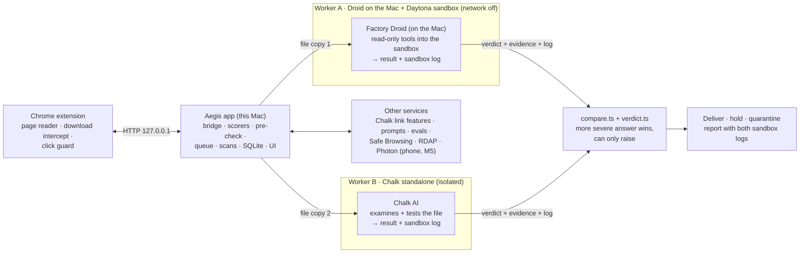
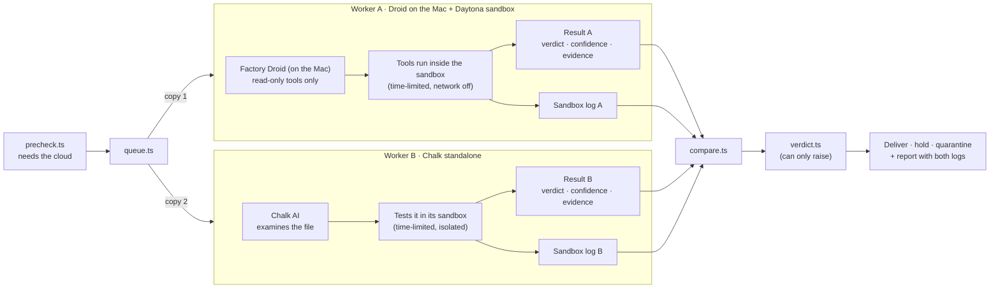
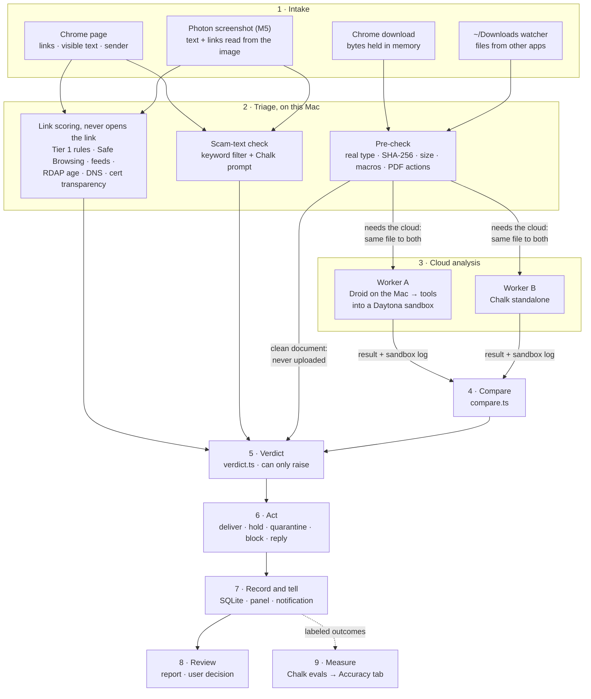
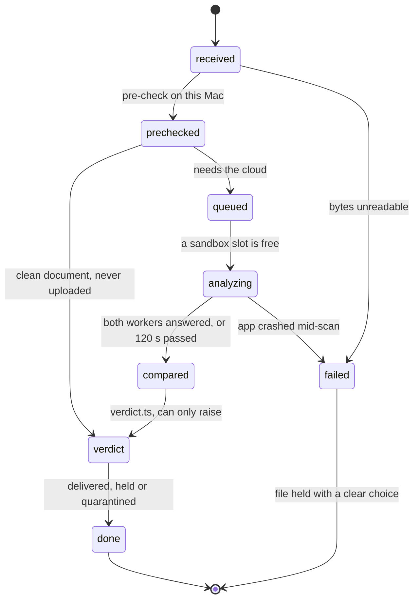
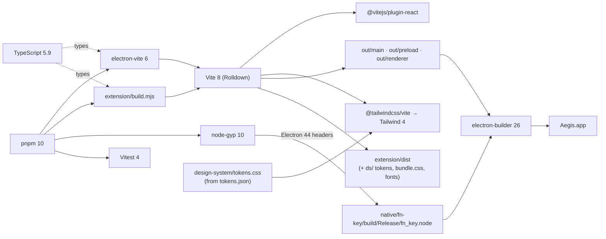
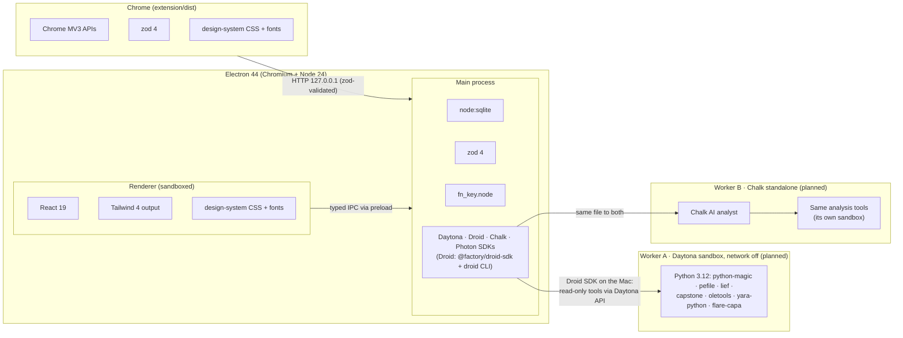
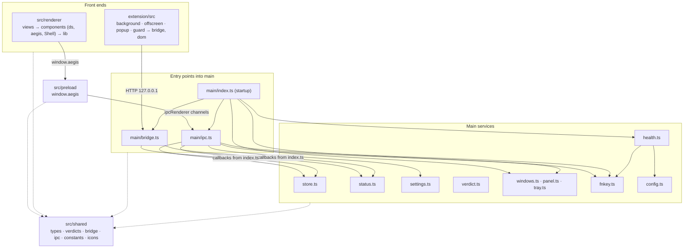
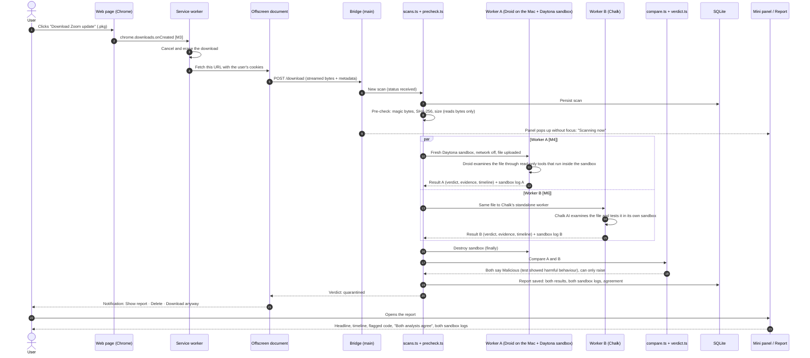
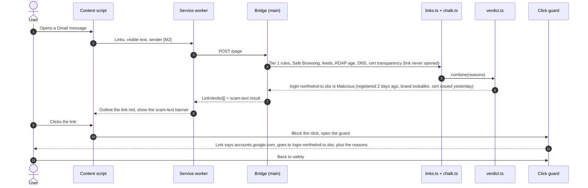

# Aegis architecture

How Aegis is put together: what each part does, how the parts relate, how data moves through
them, and which libraries hold it up. Behaviour and safety rules come from `MEGA_PROMPT.md`, build
order from `BUILD_PROMPT.md`, the look from `design-system/` and `figma/`. Live status is in
`docs/PROGRESS.md`; decisions are in `docs/PLAN.md`.

Every part below is marked **Built** (in the repo and working today) or **Planned (M*n*)** (the
milestone that builds it).

---

## 1. What Aegis is

Aegis checks links and downloads **before** they reach your Mac. Anything risky is opened in a
throwaway cloud sandbox, never on the Mac, reverse engineered, and explained in plain English with
the suspicious code as evidence. Every URL and file gets one of four verdicts: **Malicious**,
**Suspicious**, **Unknown** or **Clean**.

It works in three places:

| Where       | What the user sees                                                                                | Part                                     |
| ----------- | ------------------------------------------------------------------------------------------------- | ---------------------------------------- |
| **Chrome**  | Risky links outlined, a click guard on dangerous clicks, downloads held until scanned             | Chrome extension                         |
| **The Mac** | Menu bar icon, mini panel (fn / ⌃⌥A), main window with history and reports; `~/Downloads` watched | Electron app                             |
| **Phone**   | Forward a screenshot of something suspicious by iMessage and get a verdict back (§8)              | Photon (milestone 5, built near the end) |

All four sponsors do load-bearing work (Photon's part, the phone, is built near the end). Every
risky file is reverse engineered by **two independent workers at once**, and Aegis compares their
answers:

- **Worker A — Daytona + Factory Droid:** the file goes into a throwaway **Daytona** sandbox
  created with the network fully off. **Droid** runs on the Mac and works on the file only through
  narrow, read-only tools that act inside that sandbox (PLAN.md decision 19). If the evidence shows
  harmful behaviour, it reports the file as dangerous.
- **Worker B — Chalk (standalone):** the same job done independently by **Chalk**'s AI in its own
  isolated environment.

Both return a verdict, their evidence and **a log of what happened in their sandbox**. **Chalk**
also supplies the link threat-intel features, the LLM calls (scam text, reading screenshots) and
the evals that measure how often each worker, and the pair, is right. **Links are judged without
being opened** (decision 20): no link detonation in the current plan.

> **Changed on 2026-10-17** (see PLAN.md decisions 19–21): Droid moved from inside the sandbox to
> the Mac (the account's Daytona tier blocked Factory from sandboxes), link detonation was dropped,
> and Photon came back into scope. **Later that day (15:24) the org reached Daytona Tier 3**
> (decision 28): both choices stand, and both alternatives are now possible if the team revisits them.

---

## 2. System overview

### 2.1 The big picture



### 2.2 Inside Chrome and the app


**Trust boundaries** (MEGA_PROMPT §6, BUILD_PROMPT §2):

- **No sample ever runs on the Mac.** The main process may read bytes (pre-check) and hold or
  quarantine files. A file is tested only inside a worker's sandbox: a fresh environment per job,
  network off, time-limited, with no access to the Mac, destroyed when the job ends (local Docker
  with the same limits is the fallback if Daytona is down).
- **Two opinions, never fewer checks.** The workers run independently on their own copy of the
  file. The comparator takes the more severe answer when they disagree, and the result can only
  raise the rule-based verdict, never lower it.
- **Sandbox logs are evidence, not instructions.** Each worker's log is stored and shown in the
  report, and fenced as untrusted data whenever a model reads it.
- **Secrets stay in the main process.** API keys live in `.env` (or Electron `safeStorage`). The
  renderer gets a narrow typed API; the extension never sees a key and only talks to the bridge.
- **The bridge** listens on `127.0.0.1` only and accepts a request only when its `Origin` is the
  extension's fixed ID and its `Host` is the loopback address.
- **The renderer** runs sandboxed (`contextIsolation`, no Node, strict CSP, no remote content).
- **Untrusted text** (page text, emails, strings and code from samples) is fenced in every model
  prompt, and **AI can only raise a verdict, never lower it** (`src/main/verdict.ts`).
- **Clean documents never leave the Mac**: the pre-check clears them locally.

---

## 3. The parts, and how each relates to the whole

### 3.1 Shared contract — `src/shared/` · Built

The one set of types every other part imports, so the extension, main process and renderer can't
drift apart. Changing it is a joint decision (noted in the Handoff).

| File           | What it holds                                                                                                                                        |
| -------------- | ---------------------------------------------------------------------------------------------------------------------------------------------------- |
| `types.ts`     | zod schemas and types: `Verdict`, `Finding`, `Reason`, `LinkVerdict`, `ScanReport`, `DroidReport`, `CodeExcerpt`, `SandboxRecord`, health and status |
| `verdicts.ts`  | The only verdict → word → badge-level mapping, ranks for "AI can only raise", action labels                                                          |
| `bridge.ts`    | Every bridge route with request/response schemas (`/status`, `/ping`, `/page`, `/download`, `/inspect`, `/scan/:id`, `/trust`)                       |
| `ipc.ts`       | Every renderer ↔ main channel and its argument/result types, plus the `AegisApi` the preload exposes                                                 |
| `constants.ts` | Extension ID, bridge port, score thresholds, timeouts, file-type lists, panel size                                                                   |
| `icons.ts`     | Icon path data shared by the app and the extension                                                                                                   |

### 3.2 Chrome extension — `extension/`

The eyes in the browser. It reads pages, intercepts downloads and shows warnings, but makes no
decisions itself: every verdict comes from the app through the bridge.

| Part                          | Status          | Role                                                                                                    |
| ----------------------------- | --------------- | ------------------------------------------------------------------------------------------------------- |
| `public/manifest.json`        | Built           | MV3 manifest with a fixed `key`, so the ID is `onljkbhkoinihmjibfofcalimkolemam` everywhere             |
| `src/background.ts`           | Built (partial) | Service worker: keeps the offscreen document alive, toolbar badge. Download interception lands in M3    |
| `src/offscreen.ts`            | Built (partial) | Long-lived document: bridge heartbeat today; in-memory download fetch and streaming in M3               |
| `src/popup.ts`                | Built           | App status, page counts, recent verdicts                                                                |
| `src/guard.ts`                | Built (UI)      | Click guard in a closed Shadow DOM (Figma frame). Wired to real verdicts in M2                          |
| `src/bridge.ts`, `src/dom.ts` | Built           | Bridge client (zod-validated) and DOM helpers using the design system's classes                         |
| `src/content.ts`              | Planned (M2)    | Collects links, visible text and webmail sender; draws outlines; scam-text banner; opens the guard      |
| `build.mjs`                   | Built           | Builds each entry as a classic script with Vite; copies the design-system CSS and fonts into `dist/ds/` |

### 3.3 Electron main process — `src/main/`

The brain. It owns the bridge, every decision, every outside service, the store and the windows.

| Module                              | Status                                                                  | Role                                                                                                                                                                    |
| ----------------------------------- | ----------------------------------------------------------------------- | ----------------------------------------------------------------------------------------------------------------------------------------------------------------------- |
| `index.ts`                          | Built                                                                   | Startup order: identity → `.env` → store → bridge → IPC → tray → shortcuts → panel → health loop                                                                        |
| `bridge.ts`                         | Built (partial)                                                         | HTTP server for the extension. `/status`, `/ping`, `/trust` live; the rest answer 501 until built                                                                       |
| `store.ts`                          | Built                                                                   | SQLite schema, migrations, queries behind every screen (`node:sqlite`, no native module)                                                                                |
| `status.ts`                         | Built                                                                   | Live app status (protection state, health, page snapshot, active scans) and the scan log                                                                                |
| `health.ts`                         | Built                                                                   | Checks every connection at start, every 60 s and on demand; drives "degraded"                                                                                           |
| `sponsors.ts`                       | Built                                                                   | Real Daytona, sandbox-image and Droid checks for `health.ts`: free lookups every 60 s; a tiny live test at start and on Check now only (PLAN.md decision 27)            |
| `verdict.ts`                        | Built                                                                   | Score bands, hard rules, Unknown, "AI can only raise". Every verdict passes through here                                                                                |
| `settings.ts`, `config.ts`          | Built                                                                   | User settings in SQLite; secrets and config from `.env.local`, then `.env`                                                                                              |
| `ipc.ts`                            | Built                                                                   | Handlers for every channel in `src/shared/ipc.ts`                                                                                                                       |
| `windows.ts`, `panel.ts`, `tray.ts` | Built                                                                   | Main window, the fn/⌃⌥A mini panel (top-right, no focus steal), menu bar icon and menu                                                                                  |
| `fnkey.ts`                          | Built                                                                   | Loads `native/fn-key`; a clean fn tap toggles the panel                                                                                                                 |
| `demo.ts`, `devcapture.ts`          | Built (dev)                                                             | `AEGIS_DEMO=1` demo database; headless screenshots for design checks                                                                                                    |
| `links.ts`                          | Planned (M2)                                                            | Tier 1 link rules, Tranco, allow list, URL secret stripping, RDAP domain age, DNS and certificate-transparency checks — never opens the link (decision 20)              |
| `chalk.ts`, `text.ts`               | Planned (M6)                                                            | Chalk online features (cached), Chalk prompts for LLM calls; scam-text check                                                                                            |
| `precheck.ts`                       | Planned (M3)                                                            | Magic bytes, SHA-256, size, macro / script / PDF-action detection. Reads bytes only                                                                                     |
| `queue.ts`                          | Planned (M3)                                                            | Sandbox job queue: 3 at once, priorities, daily budget                                                                                                                  |
| `daytona.ts`, `docker.ts`           | `daytona.ts` built (branch `feature/sandbox`); `docker.ts` planned (M8) | One interface for sandboxes: create, upload, run, download, destroy (always in `finally`)                                                                               |
| `scans.ts`                          | Planned (M3)                                                            | The download pipeline and its persisted state machine (`received → … → compared → done`)                                                                                |
| `workerA.ts` (Daytona + Droid)      | Planned (M4)                                                            | Creates a network-off Daytona sandbox with the file; runs Droid on the Mac with read-only tools into it (decision 19); collects verdict, evidence and the tool-call log |
| `workerB.ts` (Chalk)                | Planned (M6)                                                            | Runs the same job through Chalk's standalone worker, collects verdict, evidence and log                                                                                 |
| `compare.ts`                        | Planned (M4, M6)                                                        | Compares the two workers' answers and produces one result for `verdict.ts` (rules in §3.6)                                                                              |
| `detonate.ts`                       | Parked                                                                  | Link detonation, dropped for now (decision 20)                                                                                                                          |
| `watcher.ts`, `quarantine.ts`       | Planned (M8)                                                            | `~/Downloads` watcher; quarantine, restore, delete                                                                                                                      |
| `photon.ts`                         | Planned (M5, late)                                                      | Phone screenshots by iMessage → read the text and links → normal checks → verdict reply (§8)                                                                            |

### 3.4 Preload — `src/preload/` · Built

The renderer's only door into the main process: `window.aegis.invoke / send / on` over a fixed
list of channels. It runs sandboxed and imports nothing at runtime except Electron and the channel
list.

### 3.5 Renderer — `src/renderer/` · Built

One React bundle for two windows, routed on the URL hash: `#/panel` is the mini panel, `#/main` is
the main window. It only displays and asks; it never decides a verdict or touches a key.

| Part                                       | Role                                                                                                           |
| ------------------------------------------ | -------------------------------------------------------------------------------------------------------------- |
| `views/Panel.tsx`                          | Mini panel (Figma frame): status, service dots, this page, scanning now, recent verdicts                       |
| `components/Shell.tsx`                     | Fixed frame: nav rail, top bar with ⌘K search and status chip; only the content column scrolls                 |
| `views/main/*View.tsx`                     | Overview, Links, Downloads, Report (Figma frame), Accuracy, Settings, Search; Messages is a placeholder for §8 |
| `components/ds/`                           | Typed React port of `design-system/components/bundle.js`, styled by `bundle.css`                               |
| `components/aegis.tsx`, `assets/aegis.css` | Figma-only components: VerdictBadge, StatusDot, ScanSteps, Timeline, CodeBlock, chips                          |
| `lib/hooks.ts`, `lib/format.ts`            | Live status, IPC data hooks, scan log; formatting for machine output                                           |
| `assets/main.css`                          | Tailwind v4 with the design tokens mapped in `@theme`                                                          |

### 3.6 Analysis workers — two independent reverse engineers · Planned (M3, M4, M6)

Once the local pre-check decides a file needs the cloud, `scans.ts` sends **the same file to two
workers at the same time**. Neither sees the other's answer. Each one examines the file in its own
sandbox and returns a structured result plus a log of everything that happened in its sandbox.
When both finish (or the time limit ends), `compare.ts` reconciles them.

**How Worker A works (decision 19, proven by `pnpm try:droid`):** `workerA.ts` creates a Daytona
sandbox with `networkBlockAll: true` **at creation** (it blocks even Daytona's "essential services";
on Tier 3 a sandbox without it has the whole internet, and turning it off later would leave it on
during the upload, decision 28), uploads the file, and starts a Droid
session **on the Mac** with every built-in tool switched off. Droid's only tools are read-only,
fixed commands that run inside the sandbox through Daytona's API (list the sample, describe it,
read it; later the `analyze.py` steps). A permission handler cancels any other tool use. Every
tool call is logged with time, tool, exit code and size: that is Worker A's sandbox log. The file
never shares a machine with Droid or its Factory key.

**How Worker B works (planned, M6):** a Chalk Compute sandbox (gVisor, its own network policy),
driven from a small Python helper using `chalkcompute`, with an LLM analyst reached through Chalk.
Chalk sandboxes allow outbound network **by default**, so Worker B passes a `NetworkPolicy` that
allows no hosts, and `try-chalk` proves it's off before any sample goes in.
Details in PLAN.md › Sponsor findings › Chalk.



**What each worker returns** (`WorkerResult`, to be added to `src/shared/types.ts` and validated
with zod in the main process):

| Field        | What it holds                                                                                                            |
| ------------ | ------------------------------------------------------------------------------------------------------------------------ |
| `worker`     | `daytona-droid` or `chalk`                                                                                               |
| `verdict`    | One of the four verdicts, plus `confidence` (low / medium / high)                                                        |
| `summary`    | One plain-English sentence for the report headline and notifications                                                     |
| `timeline`   | "What would have happened", step by step, each step tied to evidence                                                     |
| `evidence`   | Code snippets with file and line, findings, indicators                                                                   |
| `sandboxLog` | Time-stamped events from its own sandbox: what ran, files touched, network attempts (blocked), errors, how the run ended |
| `ran`        | Which checks ran, how long each took, whether the run fell back to static analysis, and why                              |

**How the answers are compared** (`compare.ts`):

| Situation                                              | Result                                                                              |
| ------------------------------------------------------ | ----------------------------------------------------------------------------------- |
| Both agree                                             | That verdict, confidence raised; the report says "Both analysts agree"              |
| They disagree                                          | The **more severe** verdict; the report shows both answers side by side and says so |
| Either worker's test errors or shows harmful behaviour | **Malicious**, with that worker's log and evidence as the reason                    |
| One worker fails or times out                          | The other worker's answer, marked partial; the report names the missing worker      |
| Both fail                                              | The local pre-check result only, never better than **Unknown**                      |

The comparator's result then goes through `verdict.ts`, so the workers can raise the rule-based
verdict but never lower it. A file that says "this is safe" in its own strings changes nothing.

**Limits, stated honestly:**

- Daytona sandboxes are Linux. Scripts, installer scripts and Linux binaries can be tested there;
  macOS apps and Windows programs can't run, so for those a worker examines the file statically and
  says in its log that it did.
- A test that errors is treated as dangerous, as the team specified. Benign software can also fail
  in a sandbox, so false alarms from this rule are measured in the Chalk evals (Accuracy tab) and
  tuned there.
- Answered 2026-10-17: Droid **couldn't** reach Factory from inside a Daytona sandbox on the first
  tier, hence decision 19. On Tier 3 (15:24) it can, with `domainAllowList` for Factory's hosts
  only; decision 19 stands unless the team revisits it. Chalk **can** host Worker B's sandbox (Chalk Compute).
- Droid can only do what our tools allow. That is the point (it can't wander off), but each new
  kind of evidence needs a new fixed tool.

**The sandbox images and scripts** (`sandbox/`, Python 3.12, built from `sandbox/Dockerfile` into a
snapshot so jobs start in seconds):

| Script                    | Network | Role                                                                                                                                                        |
| ------------------------- | ------- | ----------------------------------------------------------------------------------------------------------------------------------------------------------- |
| `analyze.py`              | Off     | Static tools the workers call: real type, script lines, Office macros, PDF actions, archives and `.pkg` scripts, PE/ELF/Mach-O structure, YARA, capa → JSON |
| `observe.py`              | Off     | Records what happens while a worker tests the file into the sandbox log, under a time limit                                                                 |
| `detonate.py`             | —       | Parked: link detonation is dropped for now (decision 20)                                                                                                    |
| `fetch.py`                | —       | Not needed: links in phone screenshots are checked without opening them (decision 20)                                                                       |
| `entry.py`, `rules/*.yar` | —       | Dispatcher; YARA rules including EICAR                                                                                                                      |

### 3.7 Native fn-key add-on — `native/fn-key/` · Built

A listen-only macOS CGEventTap (C, Node-API) adapted from Klair. It reports a clean fn tap; the
main process toggles the panel. It needs Input Monitoring; ⌃⌥A works without it.

### 3.8 Design references — `design-system/`, `figma/`, `screens/`

Not shipped code, but the source of the look. `design-system/tokens.json` → `tokens.css` is the
only source of colour, type and spacing (both the app and the extension import it).
`design-system/components/` is the component bundle the renderer ports. `figma/` records the Figma
file (mini panel, Report, click guard) and the specs of the four dashboard screens that `screens/`
renders as static HTML.

---

## 4. Pipeline

Everything Aegis checks moves through the same nine stages, whatever it is and wherever it came
from. A link, a downloaded file, a file another app dropped in `~/Downloads`, and (milestone 5,
built near the end) a phone screenshot sent by iMessage all enter at **Intake** and leave with a
verdict, an action and a record. Links are judged **without being opened** (decision 20).
Only files that the local pre-check can't clear go to the two cloud workers.

### 4.1 End to end



### 4.2 The stages

| #   | Stage           | Owner                                                      | In                                                                                       | Out                                                                        | Time limit                                      | If it fails                                                                                                | Status                      |
| --- | --------------- | ---------------------------------------------------------- | ---------------------------------------------------------------------------------------- | -------------------------------------------------------------------------- | ----------------------------------------------- | ---------------------------------------------------------------------------------------------------------- | --------------------------- |
| 1   | Intake          | `extension/` → `bridge.ts`; `watcher.ts`                   | A page, a download, a file in `~/Downloads`                                              | A scan or link check with an ID, persisted in SQLite                       | —                                               | App not running: Chrome lets the download through with "not scanned"; the watcher catches it on next start | Bridge built; rest M2/M3/M8 |
| 2a  | Link scoring    | `links.ts`, `chalk.ts`                                     | URLs (secrets stripped), link text, page URL                                             | `LinkVerdict` per link: score, reasons, checks that ran                    | 300 ms local, 1.5 s for Chalk                   | Chalk slow or down: local rules + cached data + direct Safe Browsing                                       | M2, M6                      |
| 2b  | Scam-text check | `text.ts`                                                  | Visible text (≤ 8,000 chars, never stored)                                               | `ScamTextResult`: score, scam type, triggering sentences                   | 8 s                                             | Skipped; link results only                                                                                 | M6                          |
| 2c  | Pre-check       | `precheck.ts`                                              | The file's bytes (read only, never opened)                                               | Real type, SHA-256, size, document risk flags, "needs the cloud" or not    | ~1 s                                            | Unreadable: held with "Can't scan right now"                                                               | M3                          |
| 3a  | Worker A        | `queue.ts` → `workerA.ts`: Droid on the Mac + Daytona      | The file in a sandbox created with `networkBlockAll`; Droid gets read-only tools into it | `WorkerResult` A + sandbox log A                                           | Sandbox start 20 s (one retry); whole job 120 s | Daytona down: same job in local Docker; neither: Worker B alone                                            | M3, M4                      |
| 3b  | Worker B        | `queue.ts` → `workerB.ts` → Chalk                          | The same file, a separate copy                                                           | `WorkerResult` B + sandbox log B                                           | Whole job 120 s                                 | Chalk down: Worker A alone                                                                                 | M6                          |
| 4   | Compare         | `compare.ts`                                               | Result A, result B, both logs                                                            | One result, agreement, which workers answered                              | Waits until both finish or 120 s pass           | One missing: the other's answer, partial; both missing: pre-check only, never better than Unknown          | M4, M6                      |
| 5   | Verdict         | `verdict.ts`                                               | Rule reasons + compared result (or link/text results)                                    | Malicious · Suspicious · Unknown · Clean, score, reasons                   | instant                                         | Can't fail open: missing evidence means Unknown, never Clean                                               | Built                       |
| 6   | Act             | `scans.ts`, `quarantine.ts`, bridge reply to the extension | Verdict + mode (block or warn)                                                           | Exact scanned bytes delivered, file held or quarantined, link blocked      | —                                               | Never loses a file: every path ends delivered, held or quarantined with a clear choice                     | M3, M8                      |
| 7   | Record and tell | `store.ts`, `status.ts`, `panel.ts`, notifications         | Scan + verdict + report                                                                  | Row in SQLite, log line, panel pop-up, notification                        | —                                               | —                                                                                                          | Store, panel built; rest M3 |
| 8   | Review          | Renderer (Report, Links, Downloads), extension popup       | The stored report                                                                        | User decision: delete, keep, download / restore anyway, trust site         | —                                               | —                                                                                                          | Screens built; actions M8   |
| 9   | Measure         | `chalk/`, `evals/`, `pnpm eval`                            | Labeled links, texts and files                                                           | Precision, recall, false alarms, time per verdict, per worker and combined | offline                                         | Accuracy tab shows "No eval run yet"                                                                       | M6                          |

### 4.3 Links, step by step

1. **Read the page** (content script, M2). Every `a[href]` and plain-text URL with its visible text,
   batched, plus new ones as the page changes. On Gmail and Outlook, the sender's name, address and
   Reply-To. The content script never calls the bridge itself; the service worker does.
2. **Strip secrets** (`links.ts`). Query parameters that look like tokens, codes, emails or session
   IDs are removed before anything leaves the Mac.
3. **Score every link** (`links.ts` + `chalk.ts`, ≤ 300 ms locally, ≤ 1.5 s with Chalk). Link text vs.
   real destination, lookalike brands, punycode, raw IPs, risky TLDs, shorteners, executable paths;
   domain age, Safe Browsing and threat-feed matches from Chalk (cached per domain for an hour).
   Trusted sites skip the heuristics but still get Safe Browsing and the feeds.
4. **Check the text** (`text.ts`, ≤ 8 s). Webmail always; other pages only when
   a cheap keyword filter or Tier 1 finds something.
5. **Verdict** (`verdict.ts`). A Safe Browsing or threat-feed match is Malicious outright.
6. **Mark the page** (content script). Suspicious links get an amber dotted outline, Malicious a red
   dashed one; a scam-text banner if the text check fired.
7. **Guard the click** (`guard.ts`). Clicking a Suspicious, Malicious or Unknown link opens the
   click guard: Back to safety, Continue anyway, Trust this site (not offered for shorteners). (**Inspect in sandbox** is to be hidden while
   detonation is dropped; `guard.ts` still shows it, PROGRESS.md › Open issues.)
8. **Look further without opening it** (`links.ts`, M2). RDAP domain age, DNS records and
   certificate-transparency logs for the domain. A short link or redirect whose destination can't
   be seen without following it is **Unknown** ("Aegis can't see where this link goes") and is
   **held at the click** until the user double-checks (PLAN.md decision 26); a redirect wrapper that
   carries its destination in the URL is unwrapped and the destination checked instead. Link
   detonation is dropped for now (decision 20).
9. **Record** (`store.ts`). The link, its verdict and reasons go to the Links screen and the panel's
   "This page" counts.

### 4.4 Files, step by step

1. **Stop the download** (service worker, M3). `chrome.downloads.onCreated` cancels and erases it.
2. **Fetch the bytes in memory** (offscreen document). Same URL, with the user's cookies, so
   logged-in downloads work; the bytes stream to `POST /download` and are never written to disk.
   If that fails, Chrome saves the file into `Downloads/.aegis-quarantine/` with a `.aegis`
   extension instead; if it already finished, the app moves it into quarantine at once. Files from
   other apps arrive the same way through the `~/Downloads` watcher.
3. **Pre-check** (`precheck.ts`, local, bytes only). Real type from magic bytes (a `photo.jpg` that is
   really an executable is treated as one), SHA-256, size, macros, embedded files, PDF actions.
   - Images, audio and video whose bytes match their type pass straight through.
   - Documents with nothing risky are **cleared on the Mac and never uploaded** (Clean, "checked on
     this Mac").
   - Everything else on the always-scan list needs the cloud.
4. **Queue** (`queue.ts`). Up to 3 jobs at once, downloads first; a daily sandbox budget.
5. **Analyse in parallel** (`workerA.ts` + `workerB.ts`). The same file goes to both workers on
   separate copies. Worker A: Droid on the Mac, read-only tools into a network-off Daytona
   sandbox. Worker B: a Chalk sandbox. Each examines it under a time limit, and
   returns a verdict, confidence, summary, timeline, evidence and its sandbox log. Worker A's Daytona
   sandbox is destroyed in a `finally`, whatever happened.
6. **Compare** (`compare.ts`). Agreement → that verdict. Disagreement → the more severe one, both
   shown. A test that errors or shows harmful behaviour → Malicious. One worker missing → the other's
   answer, marked partial. Both missing → pre-check only, at best Unknown.
7. **Verdict** (`verdict.ts`). Hard rules first (an EICAR or high-severity YARA hit, a type that lies
   about itself, an installer script that downloads and runs code), then the compared result, which
   can only raise the rule-based verdict.
8. **Act** (`scans.ts`).
   - **Clean:** the exact bytes that were scanned (checked by SHA-256) are written to `~/Downloads`
     under the original name. Never downloaded again.
   - **Unknown / Suspicious:** held, with Show report · Delete · Download anyway.
   - **Malicious:** quarantined, with Show report · Delete · Restore anyway.
   - **Warn mode:** nothing is held; the file is delivered with its verdict and report.
9. **Tell** (`status.ts`, `panel.ts`). The panel pops up without taking focus while a file is held and
   closes 8 seconds after the verdict; a notification opens the report.
10. **Report** (renderer). Verdict and risk score, the headline, finding chips, "What would have
    happened", flagged code, indicators, whether both analysts agreed, both sandbox logs, and the
    footer saying where it was scanned and when the sandbox was destroyed.

Every step is persisted, so a restart resumes or fails a scan cleanly. A failed scan always leaves
the file held or quarantined with a clear choice, never lost.



The current `ScanStatus` in `src/shared/types.ts` has `uploaded` and `reviewing`. It becomes
`received → prechecked → queued → analyzing → compared → verdict → done | failed` when M3 starts
(a joint change, noted in the Handoff).

### 4.5 When a service is down

The pipeline degrades rather than stops (MEGA_PROMPT §5.9). Defaults are for **block** mode.

| Down           | What changes                                                                                                                                                                               |
| -------------- | ------------------------------------------------------------------------------------------------------------------------------------------------------------------------------------------ |
| Daytona        | Worker A runs in local Docker with the same limits. No Docker either: Worker B carries the file alone, marked partial.                                                                     |
| Chalk          | Worker A carries the file alone, marked partial. Link scoring uses local rules + direct Safe Browsing; scam-text is skipped unless a direct model key is set.                              |
| Both workers   | Executables, installers, scripts and archives are **held** with "Can't scan right now" and Download anyway. Documents pass after the local pre-check, with a warning if it found anything. |
| Safe Browsing  | Threat feeds through Chalk plus Tier 1 rules.                                                                                                                                              |
| The app itself | The extension lets downloads through with a "not scanned" notice; the `~/Downloads` watcher scans them on next start.                                                                      |

### 4.6 Time limits

| Step                     | Limit                            | On timeout                                                   |
| ------------------------ | -------------------------------- | ------------------------------------------------------------ |
| Link scoring             | 300 ms local, 1.5 s Chalk        | Local rules + cached data                                    |
| Scam-text check          | 8 s                              | Skipped                                                      |
| Sandbox start            | 20 s                             | Retry once, then the Daytona-down path                       |
| Each worker              | 120 s, sandbox start included    | That worker counts as missing; the comparator uses the other |
| Static tools in a worker | 60 s (capa 90 s inside it)       | Results so far, marked partial                               |
| Compare                  | 120 s from the start of analysis | Compare whatever finished                                    |

---

## 5. File structure

`Planned` marks files and folders that later milestones create.

```
Aegis/
├── MEGA_PROMPT.md              product brief: behaviour, pipeline, safety, privacy
├── BUILD_PROMPT.md             how to build: stack, order, handoff protocol
├── BRAINSTORM.md               background on the choices
├── README.md                   setup, scripts, how each sponsor is used, privacy
├── package.json                pnpm scripts, exact dependency versions
├── electron.vite.config.ts     builds main, preload and renderer
├── electron-builder.yml        packages Aegis.app (appId com.aegis.app, menu bar app)
├── vitest.config.mts           unit tests
├── tsconfig*.json              node (main/preload), web (renderer); extension has its own
├── eslint.config.mjs, .prettierrc.yaml
├── .env.example                every secret and setting, with where to get it
│
├── src/
│   ├── shared/                 the contract: types, verdicts, bridge, ipc, constants, icons
│   ├── main/                   Electron main process (see §3.3)
│   │   ├── index.ts            startup
│   │   ├── bridge.ts           extension bridge          + bridge.test.ts
│   │   ├── store.ts            SQLite                    + store.test.ts
│   │   ├── verdict.ts          verdict rules             + verdict.test.ts
│   │   ├── status.ts           live status + scan log
│   │   ├── health.ts           connection checks
│   │   ├── sponsors.ts         live Daytona / image / Droid checks + sponsors.test.ts
│   │   ├── settings.ts, config.ts, ipc.ts
│   │   ├── windows.ts, panel.ts, tray.ts, fnkey.ts
│   │   ├── demo.ts, devcapture.ts            dev only
│   │   └── links.ts, chalk.ts, text.ts, precheck.ts, queue.ts, daytona.ts, docker.ts,
│   │       scans.ts, workerA.ts, workerB.ts, compare.ts, watcher.ts, quarantine.ts,
│   │       photon.ts (M5, late)                                                   Planned
│   │       detonate.ts                                                Parked (decision 20)
│   ├── preload/
│   │   └── index.ts            window.aegis
│   └── renderer/
│       ├── index.html          CSP: no remote content
│       └── src/
│           ├── main.tsx, App.tsx               theme + hash router (#/panel, #/main)
│           ├── assets/main.css, aegis.css      Tailwind + tokens; Figma-only component styles
│           ├── components/ds/                  design-system port
│           ├── components/aegis.tsx            Figma-only components
│           ├── components/Shell.tsx            window frame
│           ├── lib/hooks.ts, format.ts
│           └── views/Panel.tsx, views/main/    the screens
│
├── extension/
│   ├── build.mjs               Vite builds per entry → dist/
│   ├── public/                 manifest.json, popup.html/css, offscreen.html, guard.css,
│   │                           guard-preview.html, icons/
│   └── src/                    background, offscreen, popup, guard, guard-preview, bridge, dom
│                               content.ts, overlay wiring                          Planned (M2)
│
├── native/fn-key/              binding.gyp, src/fn_key.c → build/Release/fn_key.node (gitignored)
│
├── sandbox/                    Dockerfile, requirements.txt, fetch_capa_rules.py, selftest.py,
│                               README.md. Planned: entry.py, analyze.py, observe.py,
│                               rules/*.yar, tests (detonate.py parked, decision 20)
├── scripts/try-*.mts           live sponsor checks: try-daytona, try-droid (pass);
│                               try-chalk, try-photon still to write
├── chalk/                      chalk.yaml, pyproject.toml, uv.lock (chalk init) + README;
│                               Planned (M6): features, resolvers, Worker B helper, evals
├── evals/                      Planned (M6): labeled links, texts, files; results.json
├── demo/                       Planned (M0a/b): phishing page, scam texts, invoice email,
│                               harmless test .pkg, EICAR
│
├── design-system/              tokens.json → tokens.css (build-tokens.mjs), components/, fonts/,
│                               assets/icons/
├── figma/                      Figma file record: variables, component and screen specs, renders
├── screens/                    the four dashboard screens as static HTML
├── scripts/                    make-icons.mjs, capture.sh, not-yet.mjs
├── resources/                  tray template icons
├── build/                      app icon, entitlements
└── docs/                       PLAN.md, PROGRESS.md, architectural.md
```

---

## 6. Dependency graph

### 6.1 How the libraries work together

**Build time: what turns the source into the app and the extension.**



**Run time: which library runs where.**



| Library                       | Where it runs           | Why it is here                                                                                                                                                                                                                                   |
| ----------------------------- | ----------------------- | ------------------------------------------------------------------------------------------------------------------------------------------------------------------------------------------------------------------------------------------------ |
| Electron 44                   | The app                 | Menu bar app, windows, IPC, `safeStorage`, global shortcuts                                                                                                                                                                                      |
| electron-vite + Vite 8        | Build                   | One config builds main, preload and renderer with HMR; Vite also builds the extension                                                                                                                                                            |
| React 19                      | Renderer                | UI; the design-system bundle is ported to typed React components                                                                                                                                                                                 |
| Tailwind CSS 4                | Renderer                | Layout utilities; design tokens mapped in `@theme`, no hex values restated                                                                                                                                                                       |
| zod 4                         | Shared, main, extension | Validates every bridge payload, IPC shape and (later) each worker's result                                                                                                                                                                       |
| `node:sqlite`                 | Main                    | The local store; built into Electron's Node, so no native rebuild                                                                                                                                                                                |
| node-gyp → `fn_key.node`      | Build → main            | fn key capture (Node-API, so not tied to one Electron version)                                                                                                                                                                                   |
| electron-builder              | Packaging               | `Aegis.app` with `LSUIElement`, the Downloads usage string, the fn add-on                                                                                                                                                                        |
| Vitest                        | Tests                   | Verdict rules, bridge origin checks, store; pytest for `sandbox/` later                                                                                                                                                                          |
| ESLint + Prettier, TypeScript | Quality                 | `pnpm typecheck && pnpm lint && pnpm test` before every commit                                                                                                                                                                                   |
| Daytona + Droid, Chalk SDKs   | Main → workers          | The two analysis workers: Droid on the Mac with read-only tools into a network-off Daytona sandbox (`@daytona/sdk` 0.220.0, `@factory/droid-sdk` 0.9.1 + the `droid` CLI, proven by the try scripts); Chalk standalone (`chalkcompute`, planned) |
| Photon SDK                    | Main (M5, late)         | Phone screenshots in, verdicts out over iMessage (`spectrum-ts`, v2 beta)                                                                                                                                                                        |

### 6.2 How the code depends on itself

Each layer only calls the one below it, and every layer imports the contract in `src/shared/`.
Nothing imports the renderer or the extension.



---

## 7. Happy path

Every service is up, the extension is connected, Input Monitoring is granted. Two flows cover the
demo script (MEGA_PROMPT §8). Steps that exist today are the bridge, store, verdict rules, panel,
Report view and click guard UI; the rest are planned (milestones in brackets).

### 7.1 A risky download is caught before it reaches the Mac



If both workers return **Clean**, steps 18–21 become: the main process writes **the exact bytes it
scanned** (checked by SHA-256) to `~/Downloads` under the original name. If they disagree, the
more severe answer wins and the report shows both side by side.

### 7.2 A phishing link is stopped at the click (without opening it)



A short link whose destination can't be seen comes back **Unknown** ("Aegis can't see where this
link goes"), and clicking it opens the same guard so the user double-checks (decision 26). Link
detonation, which would have shown the landing page and a screenshot, is dropped
for now (PLAN.md decision 20).

---

## 8. Aegis on your phone (Photon) · Planned (M5, built near the end)

Aegis enters the Photon track (PLAN.md decision 21), so this is in scope, built after the core
features. The flow:

1. Someone gets a suspicious text, email or web page on their phone and takes a **screenshot**.
2. They send it to Aegis's iMessage number. `photon.ts` receives it through Photon's `spectrum-ts`
   SDK (v2 beta for this project) and fetches the image with `getAttachment(guid)`.
3. Aegis reads the screenshot's text, links and claimed sender through a Chalk prompt that accepts
   images, then runs the same checks as everything else: link scoring without opening any link
   (§4.3) and the scam-text check.
4. Aegis replies in the thread with a verdict (Malicious, Suspicious, Unknown or Clean), each
   link's real domain, and one plain-English sentence on why.

It adds a fourth intake to §4.1, `photon.ts` in the main process, and the Messages tab as the
history of those threads. Nothing from the screenshot is fetched or opened: links are judged the
same way as in Chrome. Details and SDK calls: PLAN.md › Sponsor findings › Photon.
